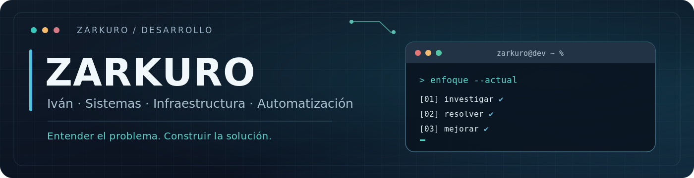

<!--
  README de perfil: Iván / Zarkuro
-->

<div align="center">
  
  <br />
  
  <br />
  
  
  
</div>

<br />

## 👋 Sobre mí

Soy **Iván** y en el ámbito de la programación utilizo el nombre **Zarkuro**. Me formo en **Ingeniería en Sistemas Computacionales** y tengo más de cinco años de experiencia en tecnologías de la información.

Gran parte de mi trabajo ha ocurrido **dentro de empresas, con usuarios reales y sistemas que necesitan seguir funcionando**: atender incidencias, diagnosticar fallas, mantener equipos y servicios, comprender procesos y proponer mejoras.

Con el tiempo he conectado ese trabajo operativo con el **desarrollo de software y la automatización**. Me gusta moverme entre infraestructura, código y soporte porque, en la práctica, los problemas no vienen etiquetados por especialidad.

> **Mi regla de trabajo:** entender el problema antes de elegir la herramienta.

## 🧭 Mi experiencia en entornos empresariales

<table>
  <tr>
    <td width="50%" valign="top">
      <h3>🛠️ Soporte y atención a usuarios</h3>
      <p>Diagnóstico y resolución de incidencias de hardware, software y operación diaria. Seguimiento de solicitudes, mantenimiento y atención directa a las personas que utilizan los sistemas.</p>
    </td>
    <td width="50%" valign="top">
      <h3>🖥️ Infraestructura y servicios</h3>
      <p>Trabajo con equipos, redes, servidores Windows y Linux, almacenamiento NAS, servicios web, accesos y entornos de operación. Investigo tanto el síntoma como su causa.</p>
    </td>
  </tr>
  <tr>
    <td valign="top">
      <h3>🧩 Sistemas empresariales</h3>
      <p>Mantenimiento, configuración y mejora de herramientas internas, aplicaciones web y bases de datos. Conozco el valor de adaptar una solución existente cuando resuelve mejor la necesidad.</p>
    </td>
    <td valign="top">
      <h3>⚙️ Automatización y mejora continua</h3>
      <p>Uso scripts y herramientas de desarrollo para reducir tareas manuales, facilitar diagnósticos y dar más claridad a procesos técnicos. Me interesan las soluciones que se puedan mantener.</p>
    </td>
  </tr>
</table>

## 🔎 Cómo me gusta trabajar

<p align="center">
  
  
  
  
</p>

No siempre hace falta escribir código. A veces la mejor solución es **corregir una configuración, ordenar un procedimiento, documentar algo confuso o evitar que una tarea se repita**. Prefiero una solución útil y comprensible antes que una complicada que solo impresione en una presentación.

## 🧰 Tecnologías con las que he trabajado

<div align="center">
  
  
  
  
  
  
  
  
  
</div>

<p align="center"><sub>Son herramientas que forman parte de mi experiencia, no una lista de cosas en las que me declaro experto.</sub></p>

## 📚 Lo que sigo explorando

Actualmente dedico tiempo a **Python y automatización**, **ciberseguridad y OSINT**, **Linux e infraestructura** y el uso de **IA para construir herramientas prácticas**. Mi objetivo es profundizar, probar ideas y aplicar lo aprendido en situaciones reales.

## 🧠 Un poco de mi personalidad

```ini
[mi_forma_de_pensar]
identidad_dev    = Zarkuro
curiosidad       = investigar por qué funciona (o por qué falla)
prioridad        = que sea útil para quien lo necesita
mentalidad       = aprender, probar y corregir
preferencia      = sistemas claros > soluciones innecesariamente complejas
chistes          = malos
```

<details>
  <summary><b>📁 Algo que no se ve en un repositorio</b></summary>
  <br />
  Una parte importante de mi experiencia sucede en empresas y sistemas internos, donde no corresponde publicar código, configuraciones o datos de terceros. Este perfil habla también de ese trabajo: resolver problemas reales, colaborar con personas y mantener tecnología en funcionamiento.
</details>

<br />

<div align="center">
  <sub><b>Zarkuro</b> · Tecnología con propósito, curiosidad y criterio.</sub>
</div>
